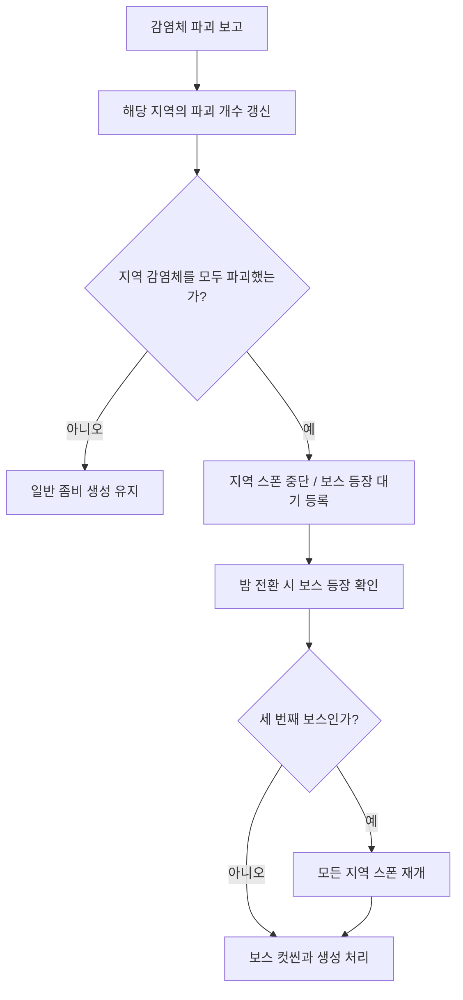

# Section Null

낮에는 농장 / 마을 / 공장의 감염체를 파괴하고, 밤에는 파괴한 순서대로 등장하는 보스를 상대하며 기지를 지키는 싱글플레이 FPS 게임입니다.

| 항목 | 내용 |
|---|---|
| 개발 형태 | 4인 팀 프로젝트 |
| 사용 기술 | Unity / C# / Animator / Rigidbody / Shader Graph / Timeline / Localization / Blender |
| 개발 기간 | 2025.09.22 ~ 2025.12.13 |
| 담당 역할 | 팀장 / 게임 진행과 기능 통합 / 아군 AI / 애니메이터와 연출 / 환경 및 설정 UI |

## 플레이 영상

추가 예정

## 목차

- [담당 범위와 협업](#담당-범위와-협업)
- [핵심 기술](#핵심-기술)
  - [1. 지역 진행과 보스전 연결](#1-지역-진행과-보스전-연결)
  - [2. 플레이어의 성장을 따라가는 기지 방어 AI](#2-플레이어의-성장을-따라가는-기지-방어-ai)
    - [바라보는 방향과 사격 방향 맞추기](#바라보는-방향과-사격-방향-맞추기)
  - [3. 애니메이터와 사망 연출 컴포넌트](#3-애니메이터와-사망-연출-컴포넌트)
    - [좀비별 애니메이션 호출 통일](#좀비별-애니메이션-호출-통일)
    - [체형에 맞춘 래그돌 설정](#체형에-맞춘-래그돌-설정)
    - [기존 외형을 유지하면서 디졸브 적용](#기존-외형을-유지하면서-디졸브-적용)
    - [1인칭 팔 모델과 무기 애니메이션 적용](#1인칭-팔-모델과-무기-애니메이션-적용)
  - [4. 게임 진행에 맞춘 컷씬과 UI 제어](#4-게임-진행에-맞춘-컷씬과-ui-제어)
  - [5. 설정 화면과 현지화 갱신](#5-설정-화면과-현지화-갱신)
- [개선할 점](#개선할-점)

## 담당 범위와 협업

팀장으로서 역할과 일정을 관리하고 회의를 진행했습니다. 

기능 개발에서는 팀원들이 만든 플레이어 / 무기 / 좀비 AI / 감염체 / 아이템 기능을 연결해 게임의 시작부터 보스전과 종료까지 이어지는 흐름을 구성했습니다.

처음에는 멀티플레이를 계획했지만, 개발 기간과 팀 내 Unity 사용 경험을 고려해 싱글플레이로 범위를 조정했습니다.

| 구분 | 담당 내용 |
|---|---|
| 게임 진행 | 시작 시 기능 초기화 / 지역별 감염체 파괴 집계 / 일반 좀비 생성 제어 / 보스 등장 / 컷씬과 종료 화면 연결 |
| 아군 AI | 표적 감지와 선택 / 사격과 재장전 / 무기 등급에 따른 강화 / 모델 회전 보정 |
| 애니메이션과 연출 | Animator 구성 / 래그돌 설정 / 디졸브 적용 / 1인칭 팔 모델 교체 / 컷씬 재생 제어 |
| 환경과 UI | 터레인 작업 / 그래픽과 입력 설정 / 효과음 재생 관리 / 일부 UI의 현지화 처리 |
| 팀원 구현과 연결 | 플레이어와 무기 시스템 / 적 AI와 스포너 / 감염체와 아이템 / 인벤토리와 강화 기능 |

좀비 담당 팀원과는 애니메이션 및 사망 연출을 호출하는 함수를 미리 맞췄습니다. `ZombieAnimator`, `RagdollMaster`, `DissolveOnDeath`를 컴포넌트로 제공해, 적의 행동과 사망 처리에서 필요한 기능을 호출할 수 있게 했습니다. 플레이어 담당 팀원과도 무기 애니메이터의 파라미터와 호출 방식을 맞춰 적용했습니다.

## 핵심 기술

### 1. 지역 진행과 보스전 연결

세 지역의 감염체 파괴 상태를 각각 관리하고, 완료한 지역부터 다음 전투로 넘어가도록 구성했습니다. 팀원이 만든 감염체와 스포너를 연결하기 위해 파괴 보고 / 생성 중단 / 보스 초기화에 사용할 함수를 확인하고 게임 진행 코드에서 호출했습니다.

[GameManager.cs](2%20Scripts/GameManager.cs)의 `AddDestroyedCells()`는 감염체가 파괴된 지역을 전달받아 파괴 개수를 갱신합니다. 해당 지역의 감염체를 모두 파괴하면 `CheckCells()`에서 스포너의 생성을 중단하고, `SetBoss()`에서 보스 등장 순서와 지역을 기록합니다.

실제 보스 생성은 낮밤 전환 코드가 밤이 되는 시점에 `CheckBoss()`를 호출하면서 진행됩니다. 지역을 완료한 순서에 따라 보스 번호가 정해지고, 생성 여부를 따로 기록해 같은 보스가 반복해서 생성되는 것을 막았습니다. 세 번째 보스가 등장할 때는 모든 지역의 일반 좀비 생성을 다시 활성화합니다.



[BossSpawner.cs](2%20Scripts/Gameplay/BossSpawner.cs)는 보스 번호와 지역을 받아 보스 오브젝트를 배치하고, 팀원의 적 초기화 함수에 이동 경로를 전달합니다. 기지에서는 [DefeatField.cs](2%20Scripts/Gameplay/DefeatField.cs)가 구역 안의 살아 있는 적을 집계해, 설정한 수에 도달하면 패배 컷씬을 실행합니다.

**관련 코드**

- 게임 초기화와 지역 진행: [2 Scripts/GameManager.cs](2%20Scripts/GameManager.cs)
- 보스 배치와 이동 경로 전달: [2 Scripts/Gameplay/BossSpawner.cs](2%20Scripts/Gameplay/BossSpawner.cs)
- 기지 패배 조건: [2 Scripts/Gameplay/DefeatField.cs](2%20Scripts/Gameplay/DefeatField.cs)
- 무기 선택 정보와 씬 전환: [2 Scripts/CustomSceneManager.cs](2%20Scripts/CustomSceneManager.cs)

---

### 2. 플레이어의 성장을 따라가는 기지 방어 AI

싱글플레이 전환 후 플레이어가 탐색과 기지 방어를 모두 맡아야 하는 문제를 보완하기 위해 아군 AI를 만들었습니다. 아군은 기지에 머물며 감지 범위 안의 적을 공격합니다.

플레이어 담당 팀원과 상의해 기존 총기 코드에서 필요한 부분을 재사용했습니다. [PlayerAI.cs](2%20Scripts/Gameplay/PlayerAI.cs)는 팀원의 `IShooter`와 `PlayerWeaponConfig`를 사용하고, AI에 필요한 표적 선택 / 공격 간격 / 탄창 / 재장전 처리를 담당합니다.

트리거에 들어온 적을 목록에 등록하고, 죽거나 비활성화된 적을 제외한 뒤 목록의 첫 번째 적을 공격합니다. 표적 위치에 높이 보정을 더해 발사 함수로 전달하고, 탄창이 비면 재장전이 끝난 뒤 사격을 재개합니다.

#### 바라보는 방향과 사격 방향 맞추기

개발 중 캐릭터가 바라보는 방향과 실제 사격 방향이 어긋나는 문제가 있었습니다. 루트 오브젝트는 표적 쪽으로 회전시키고, 애니메이션이 적용된 뒤 모델의 로컬 Y 회전을 정리하도록 수정했습니다.

아래는 [PlayerAI.cs](2%20Scripts/Gameplay/PlayerAI.cs)의 `LateUpdate()`입니다.

```csharp
void LateUpdate()
{
    if (modelRoot == null) return;

    Vector3 euler = modelRoot.localEulerAngles;
    euler.y = 0f;
    modelRoot.localEulerAngles = euler;
}
```

플레이어가 무기를 강화하면 팀원의 강화 코드가 `GameManager.UpgradeAIs()`를 호출합니다. 아군은 현재보다 높은 등급이 전달된 경우 무기 스탯 테이블을 읽어 공격력 / 탄창 / 공격 간격에 반영합니다. 플레이어가 성장할수록 기지의 방어 능력도 함께 높아지도록 연결했습니다.

**관련 코드**

- 표적 선택 / 사격 / 재장전 / 회전 보정: [2 Scripts/Gameplay/PlayerAI.cs](2%20Scripts/Gameplay/PlayerAI.cs)
- 아군 강화 전달: [2 Scripts/GameManager.cs](2%20Scripts/GameManager.cs)

---

### 3. 애니메이터와 사망 연출 컴포넌트

좀비와 무기의 기존 애니메이션 클립을 활용하고, 게임 코드에서 재생할 수 있도록 Animator와 제어 컴포넌트를 구성했습니다.

#### 좀비별 애니메이션 호출 통일

[ZombieAnimator.cs](2%20Scripts/Animation/Zombies/ZombieAnimator.cs)에 대기 / 걷기 / 달리기 / 공격 / 사망 등의 호출 함수를 두고, 좀비별 구현에서 해당 Animator의 파라미터를 변경하도록 했습니다. 적 AI 담당 팀원은 좀비마다 다른 파라미터 이름을 직접 다루는 대신 같은 함수로 행동에 필요한 애니메이션을 요청할 수 있습니다.

#### 체형에 맞춘 래그돌 설정

일반 좀비는 사람 형태여서 자동 생성한 래그돌을 적용하기 수월했지만, 일부 보스는 허벅지의 충돌 영역이나 관절 연결이 맞지 않았습니다. 일반 좀비의 구성을 참고해 보스의 Collider와 Joint를 직접 조정했습니다.

[RagdollMaster.cs](2%20Scripts/Animation/RagdollMaster.cs)는 Animator / Rigidbody / Collider의 활성 상태를 전환합니다. 래그돌로 전환할 때 애니메이터를 끄고 뼈대의 물리 처리를 활성화하며, 기존 이동용 콜라이더와 공격 판정용 콜라이더도 함께 정리합니다. 오브젝트가 다시 활성화되면 기본 상태로 복구합니다.

#### 기존 외형을 유지하면서 디졸브 적용

Shader Graph 강의를 참고해 디졸브 효과를 만들었습니다. 처음에는 모든 Material을 디졸브용으로 교체하려 했지만, 일부 에셋의 전용 Material이 표현하던 외형을 그대로 유지하기 어려웠습니다.

그래서 살아 있는 동안에는 원래 Material을 사용하고, 사망 후 사라지는 연출이 시작될 때 디졸브용 Material로 바꾸도록 했습니다. 플레이 중에는 기존 외형을 유지하면서 필요한 시점에만 디졸브 효과를 적용할 수 있었습니다.

[DissolveOnDeath.cs](2%20Scripts/Effects/DissolveOnDeath.cs)는 렌더러의 각 Material 슬롯에 교체할 Material을 지정합니다. 교체 대상이 없는 슬롯은 기존 Material을 유지하고, 같은 좀비 안에서 같은 템플릿을 사용하는 슬롯은 생성한 Material Instance를 공유합니다. 이후 `_DissolveAmount`를 시간에 따라 변경합니다.

해당 컴포넌트를 만들고 좀비를 만드는 팀원에게 `SetRagdollState` 함수의 사용법을 안내했습니다. 팀원의 일반 좀비 사망 코드에서는 `SetRagdollState(true)`를 호출하고, 일정 시간 뒤 `PlayDissolveAndHide()`를 호출한 다음 오브젝트를 풀에 반환합니다. 물리 전환과 디졸브를 각각 컴포넌트로 제공해 사망 처리에 연결했습니다.

#### 1인칭 팔 모델과 무기 애니메이션 적용

외부에서 가져온 1인칭 애니메이션마다 팔 모델이 달라, 플레이어 캐릭터의 외형과 맞추는 작업이 필요했습니다. Blender로 플레이어의 팔 모델과 1인칭 애니메이션을 가져와 팔을 교체하고 게임에 적용했습니다.

플레이어 담당 팀원과 장착 / 해제 / 발사 / 재장전 시 사용할 파라미터를 맞추고, [WeaponAnimator.cs](2%20Scripts/Animation/Weapons/WeaponAnimator.cs)에서 해당 애니메이션을 호출할 수 있도록 구성했습니다.

**관련 코드**

- 좀비 애니메이션 공통 호출: [2 Scripts/Animation/Zombies/ZombieAnimator.cs](2%20Scripts/Animation/Zombies/ZombieAnimator.cs)
- 일반 좀비 애니메이터: [2 Scripts/Animation/Zombies/NormalZombieAnimator.cs](2%20Scripts/Animation/Zombies/NormalZombieAnimator.cs)
- 보스 애니메이터: [2 Scripts/Animation/Zombies/Bosses/Boss1Animator.cs](2%20Scripts/Animation/Zombies/Bosses/Boss1Animator.cs)
- 래그돌 전환: [2 Scripts/Animation/RagdollMaster.cs](2%20Scripts/Animation/RagdollMaster.cs)
- 사망 시 Material 교체와 디졸브: [2 Scripts/Effects/DissolveOnDeath.cs](2%20Scripts/Effects/DissolveOnDeath.cs)
- 무기 애니메이션 호출: [2 Scripts/Animation/Weapons/WeaponAnimator.cs](2%20Scripts/Animation/Weapons/WeaponAnimator.cs)

---

### 4. 게임 진행에 맞춘 컷씬과 UI 제어

시작 / 보스 등장 / 승리 / 패배 컷씬을 게임 진행과 연결했습니다. [CutSceneManager.cs](2%20Scripts/CutScene/CutSceneManager.cs)에서 `PlayableDirector`를 실행하고, 컷씬 중에는 게임 시간을 멈추고 강화 UI가 열리지 않도록 팀원의 UI 제어 함수를 호출합니다.

보스 등장 시에는 열려 있는 무기 강화 화면도 닫고, 보스 종류와 지역에 맞는 컷씬을 선택합니다. 종료 후에는 상황에 따라 게임을 재개하거나 결과 화면을 표시합니다.

| 컷씬 | 종료 처리 |
|---|---|
| 게임 시작 | 게임 시간과 UI 조작 복구 / 튜토리얼 표시 |
| 보스 등장 | 게임 시간과 UI 조작 복구 |
| 승리 / 패배 | 마지막 장면 부근에서 재생 정지 / 커서 표시 / 결과 패널 활성화 |

**관련 코드**

- 컷씬 실행과 종료 화면: [2 Scripts/CutScene/CutSceneManager.cs](2%20Scripts/CutScene/CutSceneManager.cs)
- 지역별 보스 컷씬: [2 Scripts/CutScene/BossCutScene.cs](2%20Scripts/CutScene/BossCutScene.cs)
- 시작 후 튜토리얼: [2 Scripts/UI/InGame/Tutorial.cs](2%20Scripts/UI/InGame/Tutorial.cs)

---

### 5. 설정 화면과 현지화 갱신

해상도 / 화면 모드 / 프레임 제한 / 음량 / 마우스 감도 / 그래픽 품질 / 언어를 설정할 수 있도록 UI를 구성했습니다. [OptionManager.cs](2%20Scripts/OptionManager.cs)에서 설정값을 저장하고 실제 게임에 적용합니다.

영어로 설정한 상태에서 UI를 열면 기본 한국어 문구가 잠깐 보인 뒤 영어로 바뀌는 현상을 확인했습니다. 수정 범위를 고려해 코드에서 갱신하는 설정값과 무기 선택 문구부터 String Table을 직접 조회해 대입하도록 바꿨습니다.

아래는 [OptionUI.cs](2%20Scripts/UI/Options/OptionUI.cs)의 `UpdateScreenModeText()`입니다.

```csharp
private void UpdateScreenModeText()
{
    string key = screenModeKeys[indexScreenMode];

    screenModeText.text = LocalizationSettings.StringDatabase
        .GetLocalizedString(UI_TABLE, key);
}
```

옵션 화면 초기화와 언어 변경 시 `UpdateTexts()`를 호출하고, 개별 설정을 바꿀 때도 해당 문구를 갱신합니다. 내부에서 사용하는 설정값과 화면에 표시할 번역 키를 구분해, 현재 선택한 값에 맞는 문구를 코드에서 적용하도록 했습니다.

그래픽 설정은 미리 구성한 품질 단계를 `QualitySettings.SetQualityLevel()`로 전환합니다. 터레인 작업과 함께 풀 밀도 등의 환경 표현 설정을 조정했습니다.

**관련 코드**

- 설정 저장과 게임 적용: [2 Scripts/OptionManager.cs](2%20Scripts/OptionManager.cs)
- 설정 UI와 번역 문구 갱신: [2 Scripts/UI/Options/OptionUI.cs](2%20Scripts/UI/Options/OptionUI.cs)
- 무기 선택 문구 현지화: [2 Scripts/UI/MainMenu/WeaponSelect.cs](2%20Scripts/UI/MainMenu/WeaponSelect.cs)

## 개선할 점

지역 진행 상태를 자료 구조로 묶어, 지역별 파괴 개수 / 스포너 / 보스 등장 위치를 함께 관리하고 싶습니다. 현재 반복되는 분기와 지역 변수 전달을 줄일 수 있습니다.
